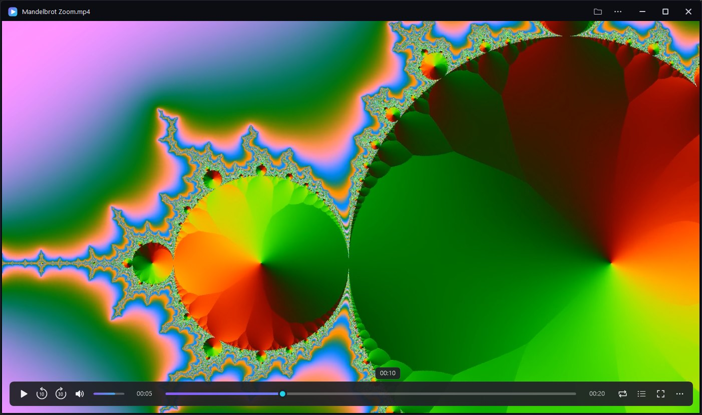
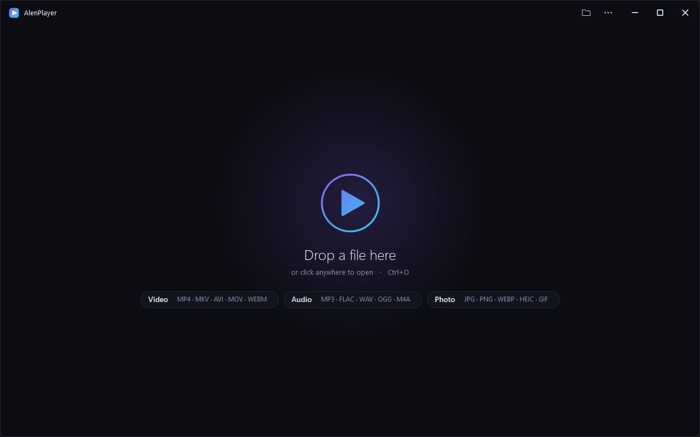
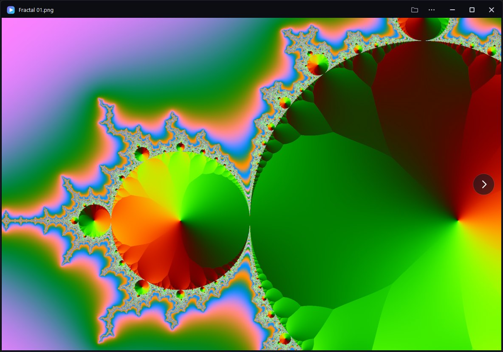

<p align="center">
  
</p>

<h1 align="center">AlenPlayer</h1>

<p align="center">
  A lightweight, portable media player for Windows — video, music and photos in one clean window.
</p>

<p align="center">
  <b>English</b> · <a href="README.ru.md">Русский</a>
</p>

<p align="center">
  
  
  
  
</p>

<p align="center">
  
</p>

---

## ✨ Features

- 🎬 **Plays almost anything** — powered by [mpv](https://mpv.io) and FFmpeg
  - Video: MP4, MKV, AVI, MOV, WEBM, FLV, TS, HEVC, AV1…
  - Audio: MP3, FLAC, WAV, OGG, OPUS, M4A, APE…
  - Photos: JPG, PNG, WEBP, HEIC, AVIF, GIF, TIFF, JXL, TGA, PSD…
- ⚡ **Hardware decoding** — a 1080p video uses a fraction of one percent of the CPU
- 🎛️ **Windows Media Player–style controls** — visible while paused, fading out smoothly during playback
- ⬅️➡️ **Flip through a folder** — hover arrows and click zones at the left/right edges, or PgUp / PgDn
- 🖼️ **Photo viewer** — zoom to the cursor with the mouse wheel, drag within the frame, rotate, slideshow
- 🎵 **Music visualizer** for audio files
- 📁 **Explorer thumbnails** for videos, album art and rare image formats
- 🌐 **11 languages** — English, Русский, Українська, Қазақша, O'zbekcha, Español, Deutsch, Français, Português, Türkçe, 中文 —
  picked automatically from your Windows language, switchable in **⋯ → Language**
- 📦 **Portable** — no installer, just unzip and run

<table>
  <tr>
    <td></td>
    <td></td>
  </tr>
  <tr>
    <td align="center"><sub>Start screen — drop a file or click to open</sub></td>
    <td align="center"><sub>Photo viewer with navigation arrows</sub></td>
  </tr>
</table>

## 📥 Download

1. Download **`AlenPlayer-<version>-win64.zip`** from the [Releases](../../releases) page.
2. Extract it to any folder — `AlenPlayer.exe` and `libmpv-2.dll` must stay together.
3. Run `AlenPlayer.exe`.

To open files with a double-click: **⋯ menu → Set as default player…**

> [!NOTE]
> The app is not digitally signed, so Windows SmartScreen may say *"Unknown publisher"*.
> Click **More info → Run anyway**.

## 💻 Requirements

| | |
|---|---|
| **OS** | Windows 10 (version 1903+) or Windows 11, **64-bit** |
| **Runtime** | .NET Framework 4.8 — already built into Windows 10 1903+ and Windows 11 |
| **Graphics** | Any GPU with DirectX 11 (works without one too, just slower) |
| **ARM laptops** | Windows 11 on ARM via x64 emulation |

Windows 7 / 8.1 and 32-bit Windows are not supported.

## ⌨️ Keyboard shortcuts

| Key | Action |
|---|---|
| `Space` / click on video | Play / pause (slideshow for photos) |
| `F` `Enter` `F11` / double-click | Fullscreen · `Esc` to exit |
| `←` `→` | Seek 5 s (`Shift` 1 s, `Ctrl` 30 s) · previous / next photo |
| `PgUp` `PgDn` / click at the edge | Previous / next file |
| `↑` `↓` / mouse wheel | Volume (wheel zooms photos) |
| `M` | Mute |
| `L` | Playlist |
| `[` `]` / `Backspace` | Speed / reset speed |
| `.` `,` | Next / previous frame |
| `+` `−` `0` | Zoom in / out / fit to window |
| `R` | Rotate 90° |
| `S` | Screenshot to desktop |
| `Ctrl+O` | Open file |

## 🗂️ Where data is stored

| What | Where |
|---|---|
| Settings, resume positions | `%APPDATA%\AlenPlayer` |
| File type icons, thumbnail handler | `%LOCALAPPDATA%\AlenPlayer` |
| Thumbnails and file associations | Current user's registry (`HKCU`), no admin rights needed |

To remove everything: **⋯ menu → Remove AlenPlayer from system**, then delete the program folder.

<details>
<summary><b>How Explorer thumbnails work</b></summary>

<br>

Explorer loads a tiny COM handler — a copy of the program kept in `%LOCALAPPDATA%\AlenPlayer\shell`,
so the program folder itself is never locked. The actual frame is extracted by a separate
`AlenPlayer.exe --thumb` process with below-normal priority (at most two at a time). The video engine
is never loaded into Explorer, and a broken file cannot crash it. JPG, PNG, WEBP, HEIC and other
formats that Windows already handles keep the standard Windows thumbnails.

</details>

## 🛠️ Building from source

All you need is Windows 10/11 x64 — the C# compiler from .NET Framework 4.x is already part of Windows.

```powershell
.\build.ps1
```

On the first run the script downloads a pinned libmpv build from
[shinchiro/mpv-winbuild-cmake](https://github.com/shinchiro/mpv-winbuild-cmake) into `vendor\`, then produces:

- `dist\AlenPlayer\` — `AlenPlayer.exe` + `libmpv-2.dll`
- `dist\AlenPlayer-<version>-win64.zip` — ready for Releases
- `AlenPlayer.exe` + `libmpv-2.dll` in the project root — ready to run

<details>
<summary><b>Project structure</b></summary>

```
src/
  Program.cs      entry point, --thumb / --register / --unregister modes
  MainForm.cs     main window, playback control
  Overlay.cs      control bar and arrows (layered windows over the video)
  Controls.cs     title bar, playlist, start screen
  Mpv.cs          libmpv wrapper
  Thumbnails.cs   Explorer thumbnail provider
  Assoc.cs        file type and thumbnail registration
  Lang.cs         language selection, plural forms
  LangData.cs     translations (generated, do not edit)
  Icons.cs        vector icons and app icon
  Theme.cs, Formats.cs, Menu.cs, Settings.cs, Native.cs
  app.manifest
tools/
  translations.py         all translations — edit here
  check_translations.py   checks that every UI string is translated
docs/             logo and screenshots
build.ps1         build script
```

</details>

<details>
<summary><b>Adding or fixing a translation</b></summary>

<br>

UI strings in the code look like `L.T("русский", "english")`. Other languages live in
`tools/translations.py`, keyed by the English text. After editing it:

```powershell
python tools/translations.py         # regenerates src/LangData.cs
python tools/check_translations.py   # makes sure nothing is missing
.\build.ps1
```

</details>

## 📄 License

AlenPlayer is licensed under the **GNU General Public License v3.0** — see [`LICENSE`](LICENSE).
This is required because the bundled libmpv is built with GPL components of mpv and FFmpeg.
Licenses and source code of bundled components are listed in [`THIRD-PARTY-NOTICES.md`](THIRD-PARTY-NOTICES.md).

What's new in each version: [`CHANGELOG.md`](CHANGELOG.md).

## 🙏 Credits

- [mpv](https://github.com/mpv-player/mpv) — the playback engine
- [FFmpeg](https://ffmpeg.org) — decoders for practically every format
- [shinchiro/mpv-winbuild-cmake](https://github.com/shinchiro/mpv-winbuild-cmake) — Windows builds of libmpv
