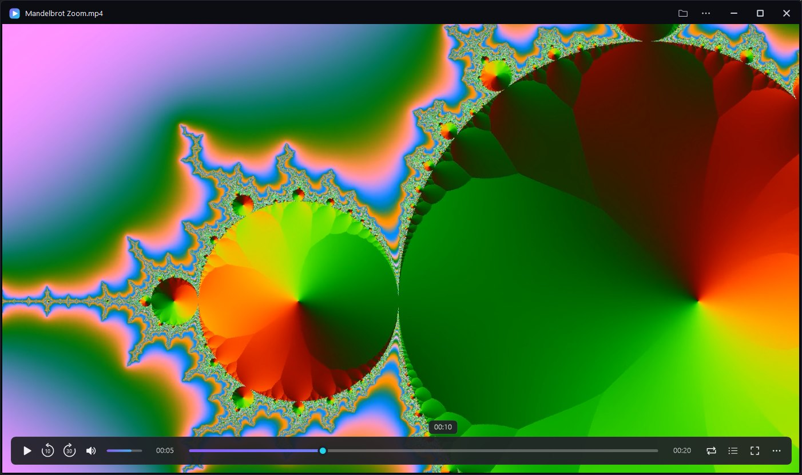
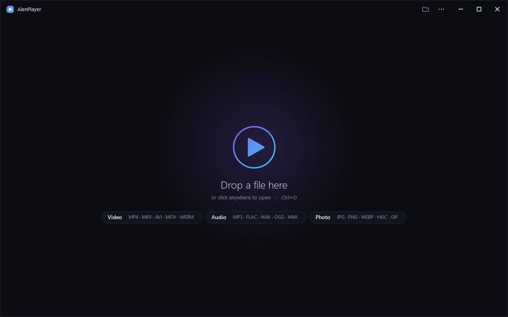
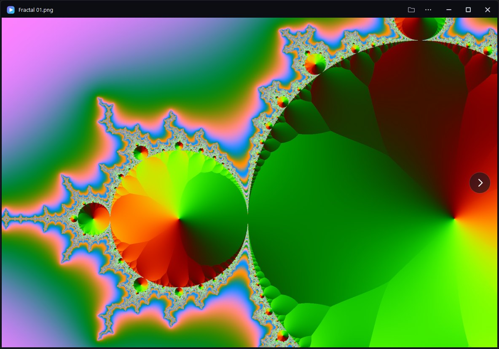

<p align="center">
  
</p>

<h1 align="center">AlenPlayer</h1>

<p align="center">
  Лёгкий портативный медиаплеер для Windows — видео, музыка и фото в одном аккуратном окне.
</p>

<p align="center">
  <a href="README.md">English</a> · <b>Русский</b>
</p>

<p align="center">
  
  
  
  
</p>

<p align="center">
  
</p>

---

## ✨ Возможности

- 🎬 **Открывает почти всё** — движок [mpv](https://mpv.io) и FFmpeg
  - Видео: MP4, MKV, AVI, MOV, WEBM, FLV, TS, HEVC, AV1…
  - Аудио: MP3, FLAC, WAV, OGG, OPUS, M4A, APE…
  - Фото: JPG, PNG, WEBP, HEIC, AVIF, GIF, TIFF, JXL, TGA, PSD…
- ⚡ **Аппаратное декодирование** — видео 1080p занимает доли процента процессора
- 🎛️ **Панель управления в стиле проигрывателя Windows** — видна на паузе, плавно исчезает во время просмотра
- ⬅️➡️ **Листание файлов папки** — стрелки и клик у левого/правого края окна, PgUp / PgDn
- 🖼️ **Просмотр фото** — масштаб колесом к курсору, перетаскивание в пределах кадра, поворот, слайд-шоу
- 🎵 **Визуализатор** для музыки
- 📁 **Миниатюры в Проводнике** для видео, обложек альбомов и редких форматов фото
- 🌐 **11 языков** — English, Русский, Українська, Қазақша, O'zbekcha, Español, Deutsch, Français, Português, Türkçe, 中文 —
  выбирается автоматически по языку Windows, меняется в **⋯ → Language / Язык**
- 📦 **Портативный** — без установки: распаковал и запустил

<table>
  <tr>
    <td></td>
    <td></td>
  </tr>
  <tr>
    <td align="center"><sub>Стартовый экран — перетащите файл или нажмите, чтобы открыть</sub></td>
    <td align="center"><sub>Просмотр фото со стрелками листания</sub></td>
  </tr>
</table>

## 📥 Скачать

1. Скачайте **`AlenPlayer-<версия>-win64.zip`** со страницы [Releases](../../releases).
2. Распакуйте в любую папку — `AlenPlayer.exe` и `libmpv-2.dll` должны лежать рядом.
3. Запустите `AlenPlayer.exe`.

Чтобы файлы открывались двойным кликом: **меню ⋯ → Сделать плеером по умолчанию…**

> [!NOTE]
> Программа не подписана цифровой подписью, поэтому Windows SmartScreen может показать
> «Неизвестный издатель». Нажмите **Подробнее → Выполнить в любом случае**.

## 💻 Требования

| | |
|---|---|
| **Система** | Windows 10 (версия 1903+) или Windows 11, **64-битная** |
| **Среда** | .NET Framework 4.8 — уже встроен в Windows 10 1903+ и Windows 11 |
| **Графика** | Любая видеокарта с DirectX 11 (без неё тоже работает, но медленнее) |
| **ARM-ноутбуки** | Windows 11 на ARM — через эмуляцию x64 |

Windows 7 / 8.1 и 32-битная Windows не поддерживаются.

## ⌨️ Горячие клавиши

| Клавиша | Действие |
|---|---|
| `Пробел` / клик по видео | Пауза (для фото — слайд-шоу) |
| `F` `Enter` `F11` / двойной клик | Полный экран · `Esc` — выход |
| `←` `→` | Перемотка 5 с (`Shift` — 1 с, `Ctrl` — 30 с) · для фото — листать |
| `PgUp` `PgDn` / клик у края | Предыдущий / следующий файл |
| `↑` `↓` / колесо мыши | Громкость (для фото колесо — масштаб) |
| `M` | Без звука |
| `L` | Плейлист |
| `[` `]` / `Backspace` | Скорость / сбросить скорость |
| `.` `,` | Кадр вперёд / назад |
| `+` `−` `0` | Приблизить / отдалить / по размеру окна |
| `R` | Повернуть на 90° |
| `S` | Скриншот на рабочий стол |
| `Ctrl+O` | Открыть файл |

## 🗂️ Где хранятся данные

| Что | Где |
|---|---|
| Настройки, места остановки видео | `%APPDATA%\AlenPlayer` |
| Значки типов файлов, обработчик миниатюр | `%LOCALAPPDATA%\AlenPlayer` |
| Миниатюры и ассоциации файлов | Реестр текущего пользователя (`HKCU`), без прав администратора |

Удалить всё: **меню ⋯ → Удалить AlenPlayer из системы**, затем удалите папку программы.

<details>
<summary><b>Как устроены миниатюры в Проводнике</b></summary>

<br>

Проводник загружает крошечный COM-обработчик — копию программы в `%LOCALAPPDATA%\AlenPlayer\shell`,
поэтому сама папка программы никогда не блокируется. Кадр извлекает отдельный процесс
`AlenPlayer.exe --thumb` с пониженным приоритетом (не больше двух одновременно). Видеодвижок
не загружается в Проводник, а повреждённый файл не может его уронить. Для JPG, PNG, WEBP, HEIC
и других форматов, которые Windows умеет показывать сама, остаются стандартные миниатюры.

</details>

## 🛠️ Сборка из исходников

Нужна только Windows 10/11 x64 — компилятор C# из .NET Framework 4.x уже входит в систему.

```powershell
.\build.ps1
```

При первом запуске скрипт скачает зафиксированную сборку libmpv из
[shinchiro/mpv-winbuild-cmake](https://github.com/shinchiro/mpv-winbuild-cmake) в `vendor\` и создаст:

- `dist\AlenPlayer\` — `AlenPlayer.exe` + `libmpv-2.dll`
- `dist\AlenPlayer-<версия>-win64.zip` — архив для Releases
- `AlenPlayer.exe` + `libmpv-2.dll` в корне проекта — готово к запуску

<details>
<summary><b>Структура проекта</b></summary>

```
src/
  Program.cs      точка входа, режимы --thumb / --register / --unregister
  MainForm.cs     главное окно, управление воспроизведением
  Overlay.cs      панель управления и стрелки (слоёные окна поверх видео)
  Controls.cs     заголовок окна, плейлист, стартовый экран
  Mpv.cs          обёртка над libmpv
  Thumbnails.cs   миниатюры для Проводника
  Assoc.cs        регистрация форматов и миниатюр
  Lang.cs         выбор языка, склонения
  LangData.cs     переводы (генерируется, не редактировать)
  Icons.cs        векторные иконки и значок приложения
  Theme.cs, Formats.cs, Menu.cs, Settings.cs, Native.cs
  app.manifest
tools/
  translations.py         все переводы — редактировать здесь
  check_translations.py   проверка, что все строки переведены
docs/             логотип и скриншоты
build.ps1         скрипт сборки
```

</details>

<details>
<summary><b>Как добавить или исправить перевод</b></summary>

<br>

Строки интерфейса в коде выглядят так: `L.T("русский", "english")`. Остальные языки лежат в
`tools/translations.py`, ключ — английский текст. После правки:

```powershell
python tools/translations.py         # пересоздаёт src/LangData.cs
python tools/check_translations.py   # проверяет, что ничего не пропущено
.\build.ps1
```

</details>

## 📄 Лицензия

AlenPlayer распространяется под лицензией **GNU General Public License v3.0** — см. [`LICENSE`](LICENSE).
Это обязательно: в комплекте идёт libmpv, собранная с GPL-компонентами mpv и FFmpeg.
Лицензии и исходники сторонних компонентов перечислены в [`THIRD-PARTY-NOTICES.md`](THIRD-PARTY-NOTICES.md).

Что нового в каждой версии: [`CHANGELOG.md`](CHANGELOG.md).

## 🙏 Благодарности

- [mpv](https://github.com/mpv-player/mpv) — движок воспроизведения
- [FFmpeg](https://ffmpeg.org) — декодеры практически всех форматов
- [shinchiro/mpv-winbuild-cmake](https://github.com/shinchiro/mpv-winbuild-cmake) — сборки libmpv для Windows
